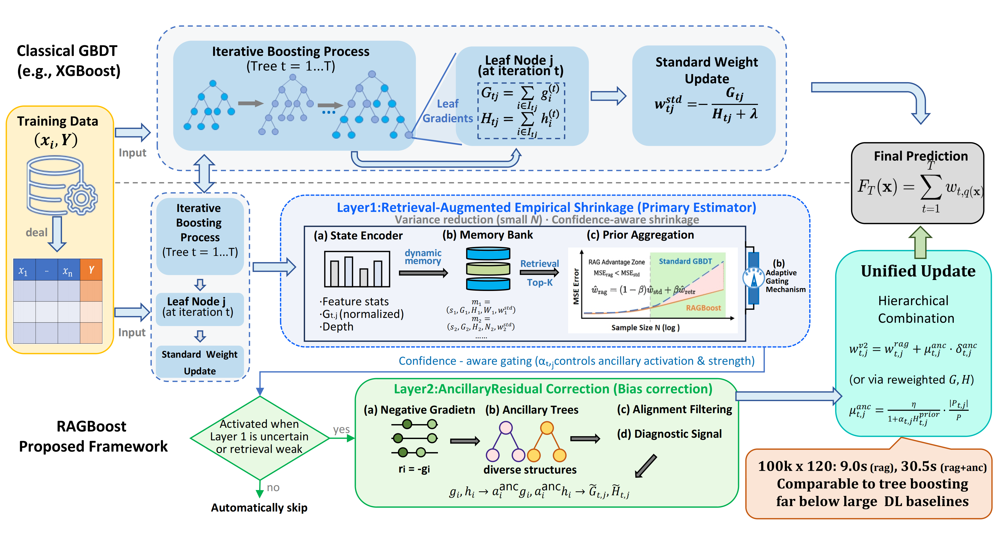

# RAGBoost：RAGBoost: Robust Tabular Learning via Retrieval-Augmented and Ancillary-Guided Gradient Boosting

## Introduction

Gradient Boosted Decision Trees (GBDTs) are widely used for tabular learning because of their strong predictive performance, computational efficiency, and ability to handle heterogeneous feature types. However, standard second-order leaf updates can become unstable in sparse leaves, where limited local samples lead to high-variance gradient estimates. In addition, heterogeneous leaves may contain residual structure that is not fully captured by the main tree.

We propose **RAGBoost**, a retrieval-augmented and ancillary-guided framework for robust tabular learning. RAGBoost introduces a two-layer, node-adaptive correction mechanism:

- **Retrieval-Augmented Empirical Shrinkage** retrieves historically observed leaves with similar gradient-state configurations and uses their statistics to construct node-conditional gradient priors. This stabilizes updates for sparse leaves while accounting for retrieval reliability.
- **Ancillary Residual Correction** uses transient ancillary trees to identify residual structure within the main tree's leaves and provide an additional gated correction signal.

These mechanisms adjust leaf values while preserving the structure of the main trees. The retrieval memory and ancillary trees are used during training and do not add components to the inference pipeline.

## Paper

- **Conference:** NeurIPS 2026
- **Paper:** [RAGBoost: Robust Tabular Learning via Retrieval-Augmented and Ancillary-Guided Gradient Boosting](https://neurips.cc/virtual/2026/loc/atlanta/poster/150352)

## Evaluation

We evaluate RAGBoost on 40 public tabular benchmarks, covering 20 classification and 20 regression datasets, and on TabReD, an industrial-scale benchmark with temporal distribution shifts.

In the paper's evaluation on the 40 public datasets, RAGBoost achieves the best result on 13 datasets. On TabReD, it obtains an average rank of 3.56 ± 2.21 among the methods reported in the paper.

## License

This project is released under the MIT License. See [LICENSE](LICENSE) for details.